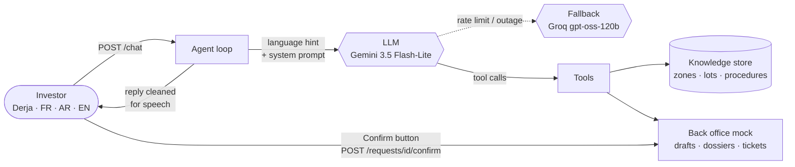

# AFI land-services agent

A multilingual AI agent that helps investors find industrial land in Tunisia, understand AFI
procedures and prepare a lot request. It understands **Tunisian Derja** (in Arabic script or
Latin-script "Arabizi"), **French**, **Modern Standard Arabic** and **English**. Built to prepare
for the [ESPRIT × IHEC Carthage × AFI Agentic Hackathon](#context) (28–29 November 2026).

> [!IMPORTANT]
> Every zone, lot, price and procedure in `data/seed.json` is **invented placeholder data**, not
> real AFI information. Replace it with data collected from AFI's public pages before any demo.

<p align="center">
  
</p>

## What it does

An investor writes the way they speak. The agent picks the right tool, answers in the same
language and script, and walks them from a question to a submitted request:

1. **Find land:** search available lots by governorate, activity sector, area and budget.
2. **Compare zones:** sectors, infrastructure, regional-development status and price ranges.
3. **Explain procedures:** steps and required documents for reserving a lot or joining an auction.
4. **Prepare a request:** fill in a draft from the conversation. The agent **cannot submit it**;
   the user reviews the draft and presses Confirm.
5. **Track a request** by its tracking number.
6. **Hand over to a human** AFI agent on request, with a ticket number.

Every answer about lots, prices and procedures comes from a tool result, not from the model's
memory, and replies are written as short plain sentences ready to be read aloud by a
text-to-speech voice.

## See it working

All animations replay **real model output**, recorded through the API with
`scripts/capture_demo.py`. Only the data behind them is invented.

<table>
  <tr>
    <td width="50%"></td>
    <td width="50%"></td>
  </tr>
  <tr>
    <td><b>One agent, three languages.</b> Arabizi, French and English questions, each answered in the user's language. The English question maps "food processing" onto the sector filter.</td>
    <td><b>Guardrails.</b> It asks for missing details instead of inventing them, declines off-topic questions without calling tools, and escalates to a person with a ticket number.</td>
  </tr>
</table>

## How it works



- **Agent loop** (`agent.py`): sends the conversation and tool definitions to the model, runs
  the tools it asks for, and repeats until it answers, with a cap of 6 steps per turn. Failed
  turns are rolled back, so a provider error never leaves a half-written conversation.
- **Tools** (`tools.py`): six tools with validated inputs. Bad input comes back to the model as
  an error it can recover from: an unknown governorate or sector returns the list of valid ones.
- **Knowledge store** (`store.py`): an in-memory store behind a `KnowledgeStore` interface.
  Governorate names match across scripts and spellings (القيروان, kairouan and 9irwen all resolve
  to Kairouan). A Neo4j schema and export are ready in `graph/`.
- **Human confirmation**: the only way to submit a request is `POST /requests/{draft_id}/confirm`,
  which the interface calls when the user presses Confirm. The model has no tool that submits.
- **Model providers** (`llm.py`): Gemini 3.5 Flash-Lite by default. If it is rate-limited or
  down, Groq takes over and stays on for 60 seconds. One adapter speaks the OpenAI-compatible
  format, so OpenRouter, Ollama or Anthropic are configuration changes.

### Making replies speakable and in the right language

Models drift towards the language of the tool data, which is French, and towards chat
formatting. Three layers handle that:

| Layer | What it does |
|---|---|
| Language hint (`language.py`) | Detects the script and language of each message (Arabic script, Arabizi, French, English) and tells the model, every turn, to answer in the same one. |
| Prompt rules | Plain sentences only, at most four; ids written exactly; never invent details; translate French terms instead of mixing scripts. |
| Speech cleanup (`speech.py`) | Strips any leftover markdown, bullets and arrows, and fixes look-alike hyphens in ids (`L‑KAI‑001` written with U+2011). |

## Evaluation

<p align="center">
  
</p>

`evals/golden.jsonl` holds **31 cases** across Tunisian Derja (both scripts), Modern Standard
Arabic, French and English. Each case is scored twice:

- **Passed:** the right tool was called with the right arguments. Some cases pass only if a tool
  is **not** called, such as preparing a request when the applicant's name is missing.
- **Style:** the reply is in the user's language and script, has no markdown, has no words mixing
  Arabic and Latin letters, and gives any ticket or draft id the tools returned.

Latest results (15 November 2026):

| Model | Passed | Style | Median answer | Slowest 5% |
|---|---|---|---|---|
| Gemini 3.5 Flash-Lite (default) | 30 / 31 | 30 / 31 | 2.4 s | 4.2 s |
| Groq `openai/gpt-oss-120b` (fallback) | 30 / 31 | 29 / 31 | 9.5 s | 19.5 s |
| Groq `qwen/qwen3.8-27b` (13-case set) | 9 / 13 | not measured | 26 s | 30 s |

Groq's times are from its free tier, where queueing varies a lot from minute to minute; its
free daily budget of about 200,000 tokens covers roughly two full runs. Neither score judges
how natural the Derja sounds. Have a native speaker review the replies,
which are saved with every run.

```bash
uv run --env-file .env python evals/run_eval.py --pause 2
```

Useful options: `--only id1,id2` runs selected cases, `--provider groq` (or `gemini`) picks the
provider, and `--model` overrides its model. The eval never uses the fallback, so each run
measures exactly one model. Each case spends API quota; results, including every reply, go to
`evals/results/`.

## What was built, step by step

1. **Scaffold:** FastAPI app, six tools, in-memory store, back-office mock, Neo4j schema and the
   first 13 golden cases.
2. **Free model providers:** an OpenAI-compatible adapter, first on Groq. Comparing Groq's two
   chat models picked `gpt-oss-120b` (13/13) over `qwen3.8-27b` (9/13, about seven times slower).
3. **Speakable replies:** reading the real replies showed markdown, French answers to English
   questions and Arabic-script answers to Arabizi. The fix was the language hint, stricter
   prompt rules, the speech cleanup and automatic style checks. Style went from 2/13 to 12/13.
4. **Harder test set:** grew to 31 cases. That exposed a sector filter the model never used (it
   then claimed unfiltered lots suited the user's activity) and escalations nobody asked for.
   Both are fixed.
5. **Gemini as default:** Gemini needs its tool-call "thought signatures" sent back on the next
   request; the adapter now does that, and only for Gemini. Gemini matched Groq's accuracy at
   about a quarter of the latency, so it became the default with Groq as fallback.

## Quickstart

Requires Python 3.11+ and [uv](https://docs.astral.sh/uv/).

```bash
uv sync
uv run pytest
cp .env.example .env   # then set GEMINI_API_KEY and GROQ_API_KEY
uv run --env-file .env uvicorn afi_agent.api:create_app --factory --reload
```

Open http://127.0.0.1:8000/docs and try `POST /chat` with a message such as
`نحب نحل معمل نسيج في القيروان، شنوة الأراضي الموجودة؟`.

Free keys: Gemini from [Google AI Studio](https://aistudio.google.com), Groq from
[console.groq.com](https://console.groq.com). Google uses free-tier Gemini data to improve its
products, so keep real investor data off the free tier.

## Project layout

| Path | Role |
|---|---|
| `src/afi_agent/agent.py` | Agent loop and system prompt |
| `src/afi_agent/tools.py` | The six tools, with validated inputs |
| `src/afi_agent/store.py` | `KnowledgeStore` interface and the in-memory store |
| `src/afi_agent/afizi_mock.py` | Stand-in for AFI's request back office |
| `src/afi_agent/llm.py` | Model adapters, Groq/Gemini fallback, and a scripted model for tests |
| `src/afi_agent/config.py` | Provider presets and settings from `.env` |
| `src/afi_agent/language.py`, `speech.py` | Language detection and speech cleanup |
| `src/afi_agent/api.py` | FastAPI app: `/chat`, `/requests/{id}/confirm`, `/health` |
| `src/afi_agent/evaluation.py`, `style_checks.py`, `evals/` | Golden set and scoring |
| `graph/`, `src/afi_agent/graph_export.py` | Neo4j schema and seed export |
| `scripts/` | Recording the demo conversations and rendering the GIFs |
| `tests/` | 137 tests, all offline: no API key needed |

## Knowledge graph

```bash
uv run python -m afi_agent.graph_export graph/seed.cypher
docker compose --env-file .env up -d
docker compose exec neo4j cypher-shell -u neo4j -p <password> -f /graph/schema.cypher
docker compose exec neo4j cypher-shell -u neo4j -p <password> -f /graph/seed.cypher
```

The graph links zones to governorates, sectors and infrastructure, lots to zones, and
procedures to required documents. The agent still reads from the in-memory store; a
Neo4j-backed store only has to implement the `KnowledgeStore` interface.

## Rebuilding the animations

```bash
uv run --env-file .env python scripts/capture_demo.py
uv run --no-project --with pillow --with arabic-reshaper --with python-bidi python scripts/make_gifs.py
```

The first command records real conversations (it spends API quota). The second renders
`docs/demo/*.gif`; its three helpers are loaded only for that run, not added to the project.

## Known limitations

- **Placeholder data:** all lots, prices and procedures are invented.
- **Derja quality is unreviewed:** Arabic-script replies often lean towards formal Arabic.
- **Invented activity:** Gemini sometimes fills in a generic activity when the user gave none.
  The draft is still shown for confirmation, but the rule does not always hold.
- **Mixed-script words** such as "أavis" still appear occasionally; the style check catches them.
- **The live switch to Groq is untested.** The fallback is covered by unit tests only.

## Not built yet

- Speech-to-text and text-to-speech (Groq offers `whisper-large-v3` on its free tier)
- Neo4j-backed `KnowledgeStore`
- Web interface: chat, push-to-talk and map
- Real AFI data

## Context

The AGENTIC HACKATHON is organised by ESPRIT with IHEC Carthage and AFI (Agence Foncière
Industrielle) on 28–29 November 2026. Its themes are agentic AI, conversational AI in Tunisian
dialect and other languages, voice AI, knowledge graphs, and AI services that make industrial
land services easier to use. This repository is independent preparation work and is not
affiliated with or endorsed by AFI.
