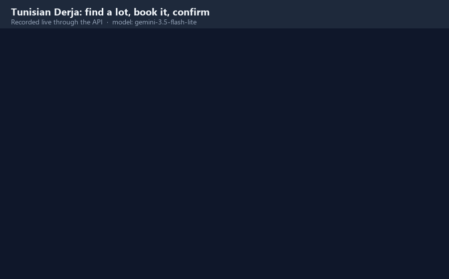
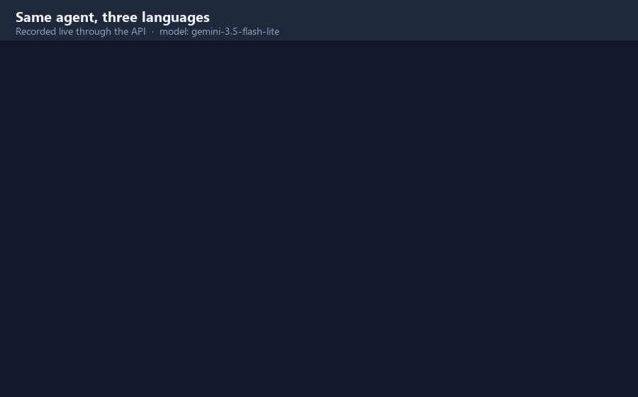
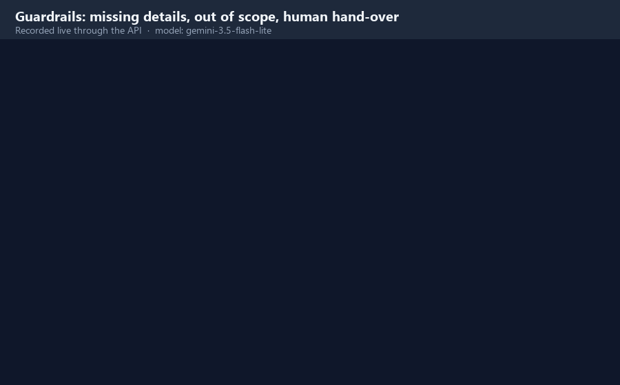
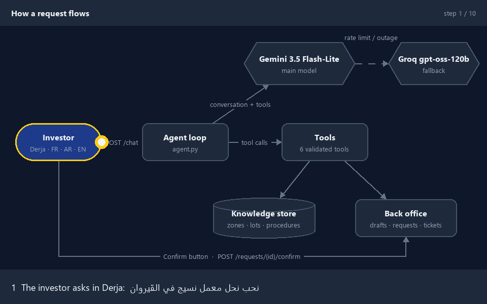
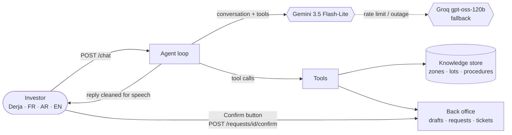
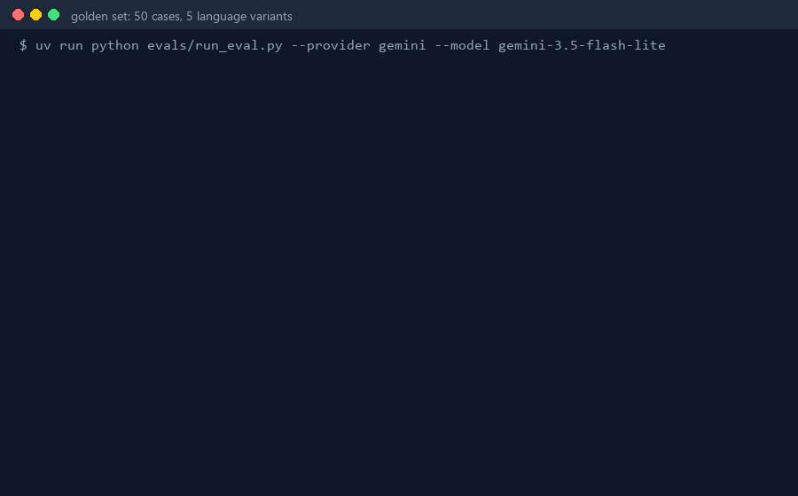

# AFI land-services agent

A multilingual AI agent that helps investors find industrial land in Tunisia, understand AFI
procedures and prepare a lot request. It understands **Tunisian Derja** (in Arabic script or
Latin-script "Arabizi"), **French**, **Modern Standard Arabic** and **English**. Built to prepare
for the [ESPRIT × IHEC Carthage × AFI Agentic Hackathon](#context) (28–29 November 2026).

> [!IMPORTANT]
> Every zone, lot, price and procedure in `data/seed.json` is **invented placeholder data**, not
> real AFI information. Replace it with data collected from AFI's public pages before any demo.

<p align="center">
  
</p>

## What it does

An investor writes the way they speak. The agent picks the right tool, answers in the same
language and script, and walks them from a question to a submitted request:

1. **Find land:** search available lots by governorate, activity sector, area and budget.
2. **Compare zones:** sectors, infrastructure, regional-development status and price ranges.
3. **Explain procedures:** steps and required documents for reserving a lot or joining an auction.
4. **Prepare a request:** fill in a draft from the conversation. The agent **cannot submit it**;
   the user reviews the draft and presses Confirm.
5. **Track a request** by its tracking number.
6. **Hand over to a human** AFI agent on request, with a ticket number.

Every answer about lots, prices and procedures comes from a tool result, not from the model's
memory, and replies are written as short plain sentences ready to be read aloud by a
text-to-speech voice.

## The web interface

Start the app (see [Quickstart](#quickstart)) and open http://127.0.0.1:8000. Its labels are
in French or Arabic (the FR / ع switch also flips the layout right-to-left); the conversation
follows whatever language the user writes or speaks.

The design treats a land request like a ticket wallet: each lot the agent finds is a coupon,
the request is a carbon copy, and confirming stamps it. Navy and coupon-white, with carbon
purple for every figure the system fills in and red for the one action that commits.

- **Conversation** with example questions, push-to-talk and an option to read replies aloud.
  Under each answer, a collapsible strip lists the lookups the agent made, with their
  arguments, results, and which model answered in how many seconds. Voice uses the browser's
  own speech recognition and voice for now (Chrome or Edge), until the Derja speech models
  are chosen.
- **Lots found**, as coupons: a large zone code (KAI, SFX, BEJ, SBZ), area, total price and
  price per m², status, and a Reserve button that starts the request. Above them, each zone's
  plots are drawn to scale by area, with the ones found highlighted. Sold and reserved lots
  carry a stamp; selecting a lot dims the others.
- **Map** of the industrial zones; the zones a search returns turn red and the map flies to
  them.
- **Your request**, as a carbon copy with the only button that submits it. Confirming presses
  a bilingual CONFIRMÉE / مؤكّدة stamp on it and reveals the tracking number; the lot turns to
  reserved on the plan.

A notice says when the data is invented, and the model chip turns amber when the fallback
model answered. The design decisions are recorded in `PRODUCT.md`, `DESIGN.md` and
`.impeccable/`.

### Offline demo mode

If the venue network or a free API fails, start the app with the offline settings, which need
no API key:

```bash
uv run --env-file .env.offline uvicorn afi_agent.api:create_app --factory
```

The agent then answers the questions recorded in `docs/demo/conversations.json` (including
all three example questions) with no network. The tools still run for real, so plots,
drafts, Confirm and tracking numbers behave as in a live demo. Other questions get a short
"offline mode" notice.

**Restart the offline server between demo runs.** Once a lot is booked it is reserved, so a
second run's search no longer returns it, and the recorded answer that names it is then
refused by the grounding check.

## See it working

All animations replay **real model output**, recorded through the API with
`scripts/capture_demo.py`. Only the data behind them is invented.

<table>
  <tr>
    <td width="50%"></td>
    <td width="50%"></td>
  </tr>
  <tr>
    <td><b>One agent, three languages.</b> Arabizi, French and English questions, each answered in the user's language. The English question maps "food processing" onto the sector filter.</td>
    <td><b>Guardrails.</b> It asks for missing details instead of inventing them, declines off-topic questions without calling tools, and escalates to a person with a ticket number.</td>
  </tr>
</table>

## How it works

<p align="center">
  
</p>

<details>
<summary>Text version of the diagram</summary>



</details>

- **Agent loop** (`agent.py`): sends the conversation and tool definitions to the model, runs
  the tools it asks for, and repeats until it answers, with a cap of 6 steps per turn. Failed
  turns are rolled back, so a provider error never leaves a half-written conversation.
- **Tools** (`tools.py`): six tools with validated inputs. Bad input comes back to the model as
  an error it can recover from: an unknown governorate or sector returns the list of valid ones.
- **Knowledge store** (`store.py`, `graph_store.py`): zones, lots and procedures, read from
  `data/seed.json` or from Neo4j (`AFI_STORE=neo4j`). Governorate names match across scripts
  and spellings (القيروان, kairouan and 9irwen all resolve to Kairouan).
- **Human confirmation**: the only way to submit a request is `POST /requests/{draft_id}/confirm`,
  which the interface calls when the user presses Confirm. The model has no tool that submits.
- **Model providers** (`llm.py`): Gemini 3.5 Flash-Lite by default. If it is rate-limited or
  down, Groq takes over and stays on for 60 seconds. One adapter speaks the OpenAI-compatible
  format, so OpenRouter, Ollama or Anthropic are configuration changes.

### Making replies speakable and in the right language

Models drift towards the language of the tool data, which is French, and towards chat
formatting. Three layers handle that:

| Layer | What it does |
|---|---|
| Language hint (`language.py`) | Detects the script and language of each message (Arabic script, Arabizi, French, English) and tells the model, every turn, to answer in the same one. |
| Prompt rules | Plain sentences only, at most four; ids written exactly; never invent details; translate French terms instead of mixing scripts. |
| Speech cleanup (`speech.py`) | Strips any leftover markdown, bullets and arrows, and fixes look-alike hyphens in ids (`L‑KAI‑001` written with U+2011). |
| One rewrite (`agent.py`) | If a reply mixes Arabic and Latin letters in one word, or spells out an id such as DRAFT-0001 in words, the model rewrites it once with the id written exactly. |

### Guardrails enforced in code

Prompt rules alone did not hold in testing, so these are checked by the program:

| Risk | What the code does |
|---|---|
| Answering from memory | A reply that names a lot id no tool returned (and the user did not type), or quotes prices or areas before any lookup, is discarded, and the turn runs again with an instruction to look the facts up. If the retry still states unverified facts, the user is asked to repeat the question instead. |
| Inventing the applicant's details | The booking tool needs the user's own words for the name and the activity; they must appear in the conversation, may not just repeat the lot request, and placeholders like "not specified" are refused. The model is told to ask instead. |
| Submitting on the user's behalf | No tool submits. Only `POST /requests/{draft_id}/confirm`, behind the interface's Confirm button, does. |
| A provider failing mid-demo | Groq takes over within the same turn; `AFI_PROVIDER=replay` works with no network at all. |

## Evaluation

<p align="center">
  
</p>

`evals/golden.jsonl` holds **50 cases** across Tunisian Derja (both scripts), Modern Standard
Arabic, French and English, four of them multi-turn (booking "the first one" after a search,
giving the name and the activity in separate messages). Each case is scored twice:

- **Passed:** the right tool was called with the right arguments. Some cases pass only if a tool
  does **not** succeed, such as preparing a request when the applicant's name is missing. An
  attempt the code blocked does not fail the case but is reported as "blocked".
- **Style:** the reply is in the user's language and script, has no markdown, has no words mixing
  Arabic and Latin letters, and gives any ticket or draft id the tools returned.

Results, 15 November 2026:

| Model | Cases | Passed | Style | Median answer | Slowest 5% |
|---|---|---|---|---|---|
| Gemini 3.5 Flash-Lite (default) | 50 | 47 | 50 | 1.9 s | 3.3 s |
| Gemini 3.5 Flash-Lite | 31 | 30 | 30 | 2.4 s | 4.2 s |
| Groq `openai/gpt-oss-120b` (fallback) | 31 | 30 | 29 | 9.5 s | 19.5 s |
| Groq `qwen/qwen3.8-27b` | 13 | 9 | not measured | 26 s | 30 s |

About the 50-case run: its three failures were all booking attempts with a missing name or
activity. The code blocked them, so no draft was created, but the scoring at the time counted
any attempt. Re-run under the current scoring, the four missing-detail cases pass 4 of 4, with
two blocked attempts. That run also predates the last two guardrails (prices and spelled-out
ids). **A full 50-case run on the final code is still to do:** the free tier's 500 requests a
day for this model were used up by the testing that found those problems.

Groq's times are from its free tier, where queueing varies a lot from minute to minute; its
free daily budget of about 200,000 tokens covers roughly two full runs. Neither score judges
how natural the Derja sounds. Have a native speaker review the replies, which are saved with
every run.

```bash
uv run --env-file .env python evals/run_eval.py --pause 2
```

Useful options: `--only id1,id2` runs selected cases, `--provider groq` (or `gemini`) picks the
provider, and `--model` overrides its model. The eval never uses the fallback, so each run
measures exactly one model. Each case spends API quota; results, including every reply, go to
`evals/results/`.

## What was built, step by step

1. **Scaffold:** FastAPI app, six tools, in-memory store, back-office mock, Neo4j schema and the
   first 13 golden cases.
2. **Free model providers:** an OpenAI-compatible adapter, first on Groq. Comparing Groq's two
   chat models picked `gpt-oss-120b` (13/13) over `qwen3.8-27b` (9/13, about seven times slower).
3. **Speakable replies:** reading the real replies showed markdown, French answers to English
   questions and Arabic-script answers to Arabizi. The fix was the language hint, stricter
   prompt rules, the speech cleanup and automatic style checks. Style went from 2/13 to 12/13.
4. **Harder test set:** grew to 31 cases. That exposed a sector filter the model never used (it
   then claimed unfiltered lots suited the user's activity) and escalations nobody asked for.
   Both are fixed.
5. **Gemini as default:** Gemini needs its tool-call "thought signatures" sent back on the next
   request; the adapter now does that, and only for Gemini. Gemini matched Groq's accuracy at
   about a quarter of the latency, so it became the default with Groq as fallback.
6. **Demo-ready:** the web interface, offline replay mode and the Neo4j-backed store. The test
   set grew to 50 cases, four of them multi-turn. Recording the demo caught Gemini once
   answering from memory with invented lot details; that and an invented-activity loophole led
   to the guardrails enforced in code. A live test confirmed Groq can finish a turn Gemini
   started.

## Quickstart

Requires Python 3.11+ and [uv](https://docs.astral.sh/uv/).

```bash
uv sync
uv run pytest
cp .env.example .env   # then set GEMINI_API_KEY and GROQ_API_KEY
uv run --env-file .env uvicorn afi_agent.api:create_app --factory --reload
```

Open http://127.0.0.1:8000 for the interface, or http://127.0.0.1:8000/docs for the API.

Free keys: Gemini from [Google AI Studio](https://aistudio.google.com), Groq from
[console.groq.com](https://console.groq.com). Google uses free-tier Gemini data to improve its
products, so keep real investor data off the free tier.

## Project layout

| Path | Role |
|---|---|
| `src/afi_agent/agent.py` | Agent loop and system prompt |
| `src/afi_agent/tools.py` | The six tools, with validated inputs |
| `src/afi_agent/store.py` | `KnowledgeStore` interface and the in-memory store |
| `src/afi_agent/graph_store.py` | Neo4j-backed store |
| `src/afi_agent/afizi_mock.py` | Stand-in for AFI's request back office |
| `src/afi_agent/llm.py` | Model adapters, Groq/Gemini fallback, and a scripted model for tests |
| `src/afi_agent/replay.py` | Offline demo mode |
| `src/afi_agent/config.py` | Provider presets and settings from `.env` |
| `src/afi_agent/language.py`, `speech.py` | Language detection and speech cleanup |
| `src/afi_agent/api.py` | FastAPI app: the interface, `/chat`, `/requests/{id}/confirm`, `/map`, `/status` |
| `src/afi_agent/web/` | The web interface (HTML, CSS, JavaScript; no build step) |
| `src/afi_agent/evaluation.py`, `style_checks.py`, `evals/` | Golden set and scoring |
| `graph/`, `src/afi_agent/graph_export.py` | Neo4j schema, seed export and loader |
| `scripts/` | Recording the demo conversations and rendering the GIFs |
| `tests/` | 187 tests, all offline: no API key needed (one needs a running Neo4j) |

## Knowledge graph

The graph links zones to governorates, sectors and infrastructure, lots to zones, and
procedures to their required documents (in order). To run the app on Neo4j, set
`NEO4J_PASSWORD` in `.env`, then:

```bash
uv sync --extra graph
docker compose --env-file .env up -d
uv run --env-file .env python -m afi_agent.graph_export load
```

Then set `AFI_STORE=neo4j` in `.env` and start the app. Neo4j is the source of truth: the app
reads the graph at startup and writes reservations back to it, which you can watch in the
Neo4j browser at http://localhost:7474. `python -m afi_agent.graph_export graph/seed.cypher`
writes the same data as a Cypher file instead.

The Neo4j store is tested against a stand-in session. The round trip through a real database
(`tests/test_graph_store.py`) runs only when `NEO4J_PASSWORD` is set, and has not been run yet.

## Rebuilding the animations

```bash
uv run --env-file .env python scripts/capture_demo.py
uv run --no-project --with pillow --with arabic-reshaper --with python-bidi python scripts/make_gifs.py
```

The first command records real conversations (it spends API quota). The second renders
`docs/demo/*.gif`; its three helpers are loaded only for that run, not added to the project.

## Known limitations

- **Placeholder data:** all lots, prices and procedures are invented.
- **Derja quality is unreviewed:** Arabic-script replies often lean towards formal Arabic.
- **The grounding check is a heuristic.** It catches lot ids no tool returned and prices or
  areas quoted before any lookup, but not a wrong price given after a correct lookup.
- **Free-tier limits:** Gemini 3.5 Flash-Lite allows 15 requests a minute and 500 a day, and
  Groq about 200,000 tokens a day. A day of rehearsals can use up the default model before a
  demo; the fallback, the offline mode or a paid key cover that.
- **Offline mode only knows the recorded questions,** and its replies quote the draft and
  tracking numbers from the recording.
- **Neo4j has not run against a real database yet** (see above).

## Not built yet

- Derja speech-to-text and text-to-speech: the interface uses the browser's voice until the
  models are compared on recorded Derja questions (Groq offers `whisper-large-v3` for free)
- Real AFI data

## Context

The AGENTIC HACKATHON is organised by ESPRIT with IHEC Carthage and AFI (Agence Foncière
Industrielle) on 28–29 November 2026. Its themes are agentic AI, conversational AI in Tunisian
dialect and other languages, voice AI, knowledge graphs, and AI services that make industrial
land services easier to use. This repository is independent preparation work and is not
affiliated with or endorsed by AFI.
